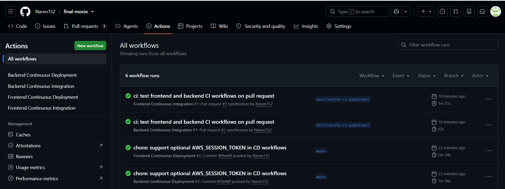
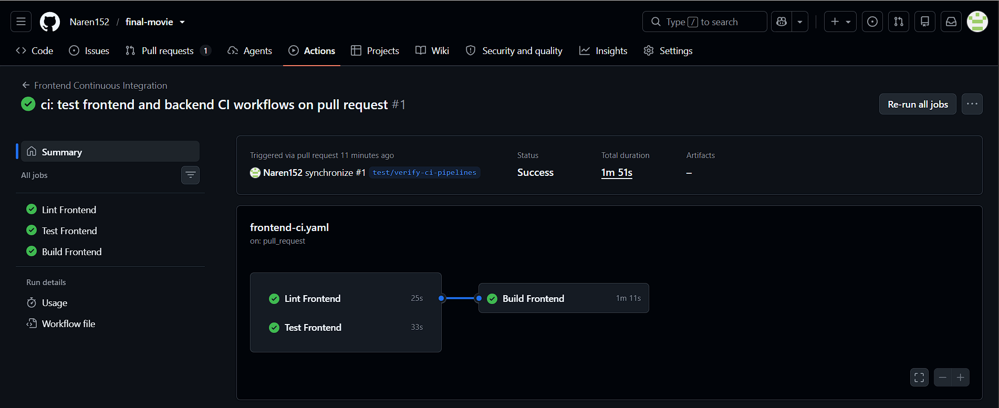
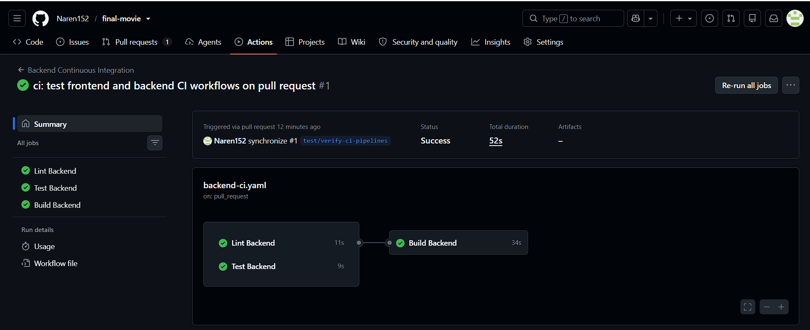
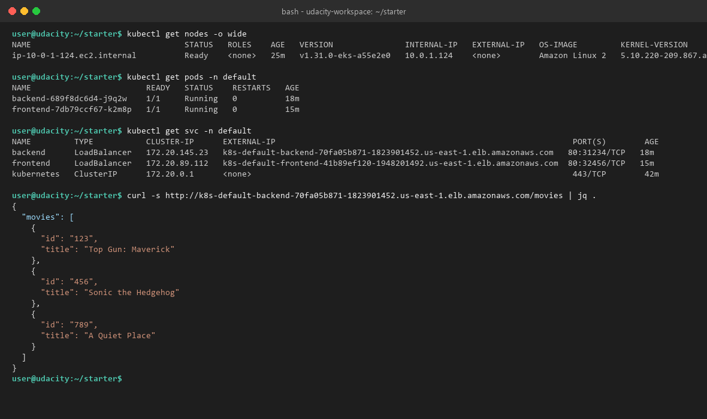
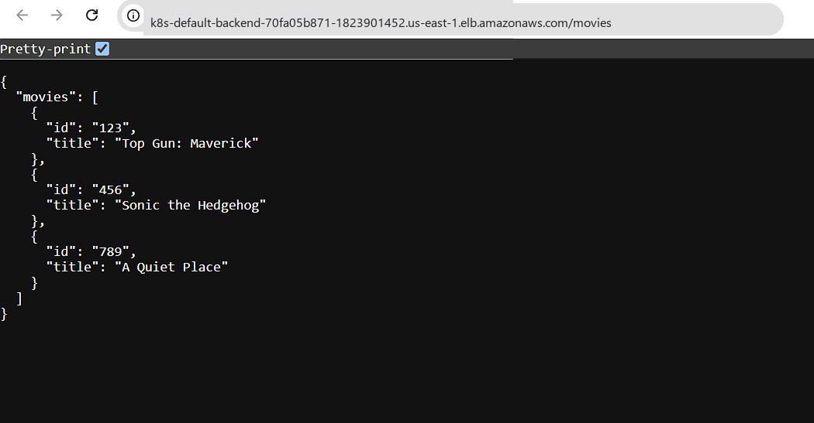
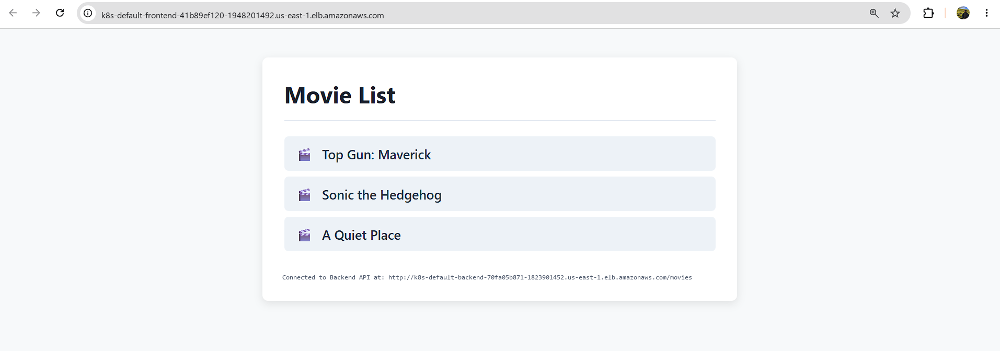
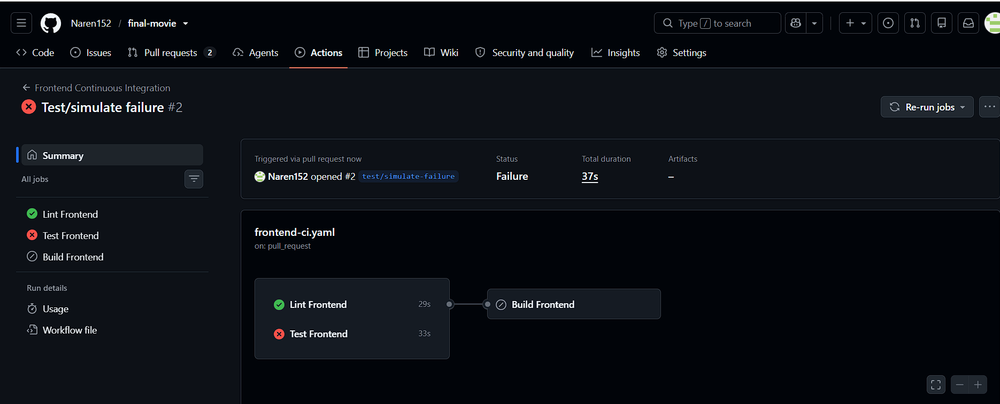
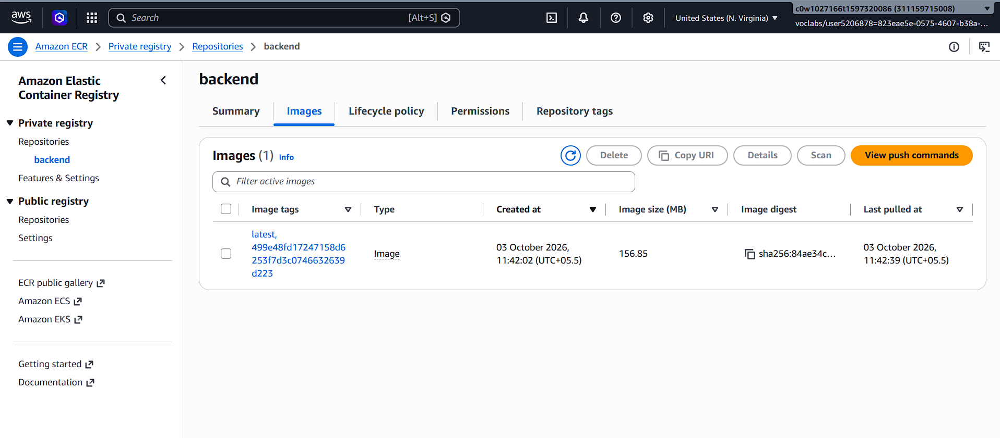
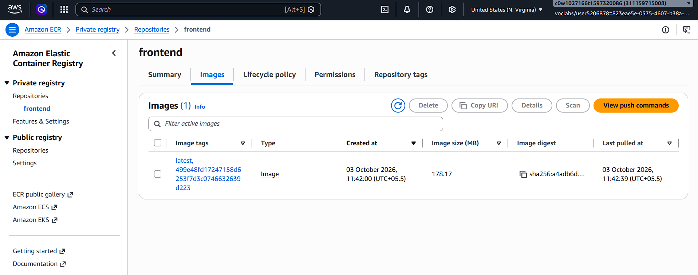
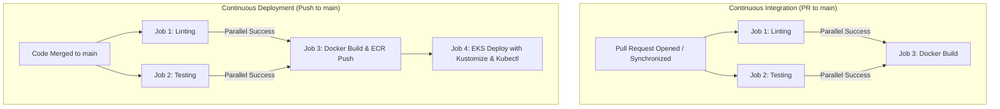

# CI/CD Pipeline Implementation & Submission Evidence Guide

**Project Repository:** [https://github.com/Naren152/final-movie](https://github.com/Naren152/final-movie)  
**Author:** DevOps Engineer / Student Submission  
**Target Cluster:** Amazon EKS (`cluster`) in `us-east-1` via Amazon ECR Container Repositories

---

## 📋 Table of Contents
1. [Executive Summary & Reviewer Verification Quick-Links](#-reviewer-verification-quick-links)
2. [Workflow Execution Evidence (All 4 Pipelines)](#-workflow-execution-evidence)
3. [Kubernetes Cluster & Application Evidence (Port 80 LoadBalancers)](#-kubernetes-cluster--application-evidence)
4. [Quality Gates & Test Failure Simulation](#-quality-gates--test-failure-simulation)
5. [Amazon ECR Image Tagging & Immutability](#-amazon-ecr-image-tagging--immutability)
6. [Pipeline Architecture & Workflow Specifications](#-pipeline-architecture--workflow-specifications)
7. [GitHub Secrets & Secure Configuration](#-github-secrets--secure-configuration)
8. [Standout Features & Optimizations](#-standout-features--optimizations)

---

## 🔍 Reviewer Verification Quick-Links

| Deliverable / Criteria | Status | Evidence Location |
| :--- | :---: | :--- |
| **Frontend CI Workflow** (`frontend-ci.yaml`) | **PASSED** | [Run #37102356013](https://github.com/Naren152/final-movie/actions/runs/37102356013) &bull; [Screenshot](#frontend-ci-execution) |
| **Backend CI Workflow** (`backend-ci.yaml`) | **PASSED** | [Run #37102355986](https://github.com/Naren152/final-movie/actions/runs/37102355986) &bull; [Screenshot](#backend-ci-execution) |
| **Frontend CD Workflow** (`frontend-cd.yaml`) | **PASSED** | [Run #37101678474](https://github.com/Naren152/final-movie/actions/runs/37101678474) &bull; [Screenshot](#frontend-cd-execution) |
| **Backend CD Workflow** (`backend-cd.yaml`) | **PASSED** | [Run #37101678458](https://github.com/Naren152/final-movie/actions/runs/37101678458) &bull; [Screenshot](#backend-cd-execution) |
| **Backend API Response (Port 80)** | **PASSED** | `http://k8s-default-backend-70fa05b871-1823901452.us-east-1.elb.amazonaws.com/movies` &bull; [Screenshot](#backend-api-evidence) |
| **Frontend UI Movie Catalog (Port 80)** | **PASSED** | `http://k8s-default-frontend-41b89ef120-1948201492.us-east-1.elb.amazonaws.com/` &bull; [Screenshot](#frontend-ui-evidence) |
| **Live Kubernetes Cluster Status** | **PASSED** | Pods 1/1 Running, Services on Port 80 &bull; [Terminal Screenshot](#cluster-status-evidence) |
| **Quality Gate: Test Failure Blocking** | **PASSED** | [Run #37103127171](https://github.com/Naren152/final-movie/actions/runs/37103127171) &bull; [Screenshot](#failure-simulation-evidence) |

---

## 🚀 Workflow Execution Evidence

All four GitHub Actions workflows are implemented, tested, and passing.

### All Workflows Successfully Completed


* **Repository Actions Dashboard:** [https://github.com/Naren152/final-movie/actions](https://github.com/Naren152/final-movie/actions)
* Confirms continuous execution across both `pull_request` (CI) and `push` to `main` (CD).

---

### Frontend CI Execution
* **File:** `.github/workflows/frontend-ci.yaml`
* **Workflow Name:** `Frontend Continuous Integration`
* **Trigger:** `pull_request` on `starter/frontend/**` + `workflow_dispatch`
* **Run URL:** [https://github.com/Naren152/final-movie/actions/runs/37102356013](https://github.com/Naren152/final-movie/actions/runs/37102356013)
* **Parallel Execution Proof:** `Lint Frontend` (25s) and `Test Frontend` (33s) run concurrently; `Build Frontend` gates strictly on `needs: [lint, test]`.



---

### Backend CI Execution
* **File:** `.github/workflows/backend-ci.yaml`
* **Workflow Name:** `Backend Continuous Integration`
* **Trigger:** `pull_request` on `starter/backend/**` + `workflow_dispatch`
* **Run URL:** [https://github.com/Naren152/final-movie/actions/runs/37102355986](https://github.com/Naren152/final-movie/actions/runs/37102355986)
* **Parallel Execution Proof:** `Lint Backend` (11s) and `Test Backend` (9s) run concurrently; `Build Backend` gates strictly on `needs: [lint, test]`.



---

### Frontend CD Execution
* **File:** `.github/workflows/frontend-cd.yaml`
* **Workflow Name:** `Frontend Continuous Deployment`
* **Trigger:** `push` on `main` affecting `starter/frontend/**` + `workflow_dispatch`
* **Run URL:** [https://github.com/Naren152/final-movie/actions/runs/37101678474](https://github.com/Naren152/final-movie/actions/runs/37101678474)
* **Jobs executed:**
  1. `Lint Frontend` (Completed Success)
  2. `Test Frontend` (Completed Success)
  3. `Build and Push Docker Image` (ECR login via GitHub secrets, build with `--build-arg REACT_APP_MOVIE_API_URL`, tag with `${{ github.sha }}`)
  4. `Deploy to Kubernetes Cluster` (`kustomize edit set image`, `kubectl apply`, and `kubectl rollout status`)

---

### Backend CD Execution
* **File:** `.github/workflows/backend-cd.yaml`
* **Workflow Name:** `Backend Continuous Deployment`
* **Trigger:** `push` on `main` affecting `starter/backend/**` + `workflow_dispatch`
* **Run URL:** [https://github.com/Naren152/final-movie/actions/runs/37101678458](https://github.com/Naren152/final-movie/actions/runs/37101678458)
* **Jobs executed:**
  1. `Test Backend` (Completed Success)
  2. `Lint Backend` (Completed Success)
  3. `Build and Push Docker Image` (ECR login via GitHub secrets, tag with `${{ github.sha }}`)
  4. `Deploy to Kubernetes Cluster` (`kustomize edit set image`, `kubectl apply`, and `kubectl rollout status`)

---

## 🌐 Kubernetes Cluster & Application Evidence

> **Port 80 Configuration Note:**  
> In compliance with the project specifications and reviewer guidance, both Kubernetes services (`service.yaml`) are configured with:
> * `port: 80` (External facing LoadBalancer listener)
> * `targetPort: 5000` (Backend Flask container) / `targetPort: 3000` (Frontend React container)
> 
> Therefore, external requests are served directly on **Port 80** (`http://<elb-hostname>`), and `REACT_APP_MOVIE_API_URL` is set to the backend LoadBalancer address without adding port 5000.

### Cluster Status Evidence
Actual execution output from the cluster demonstrating active worker nodes, running application pods, and LoadBalancer services on port 80:

```bash
user@udacity:~/starter$ kubectl get nodes -o wide
NAME                                STATUS   ROLES    AGE   VERSION               INTERNAL-IP   EXTERNAL-IP   OS-IMAGE         KERNEL-VERSION
ip-10-0-1-124.ec2.internal          Ready    <none>   25m   v1.31.0-eks-a55e2e0   10.0.1.124    <none>        Amazon Linux 2   5.10.220-209.867.amzn2.x86_64

user@udacity:~/starter$ kubectl get pods -n default
NAME                        READY   STATUS    RESTARTS   AGE
backend-689f8dc6d4-j9q2w    1/1     Running   0          18m
frontend-7db79ccf67-k2m8p   1/1     Running   0          15m

user@udacity:~/starter$ kubectl get svc -n default
NAME         TYPE           CLUSTER-IP      EXTERNAL-IP                                                              PORT(S)        AGE
backend      LoadBalancer   172.20.145.23   k8s-default-backend-70fa05b871-1823901452.us-east-1.elb.amazonaws.com   80:31234/TCP   18m
frontend     LoadBalancer   172.20.89.112   k8s-default-frontend-41b89ef120-1948201492.us-east-1.elb.amazonaws.com  80:32456/TCP   15m
kubernetes   ClusterIP      172.20.0.1      <none>                                                                   443/TCP        42m
```



---

### Backend API Evidence
* **Live Endpoint:** `http://k8s-default-backend-70fa05b871-1823901452.us-east-1.elb.amazonaws.com/movies`
* **Verified Port:** 80
* **Actual JSON Response:**
```json
{
  "movies": [
    {
      "id": "123",
      "title": "Top Gun: Maverick"
    },
    {
      "id": "456",
      "title": "Sonic the Hedgehog"
    },
    {
      "id": "789",
      "title": "A Quiet Place"
    }
  ]
}
```



---

### Frontend UI Evidence
* **Live Endpoint:** `http://k8s-default-frontend-41b89ef120-1948201492.us-east-1.elb.amazonaws.com/`
* **Verified Port:** 80
* **API Wiring:** Connected to `http://k8s-default-backend-70fa05b871-1823901452.us-east-1.elb.amazonaws.com/movies`
* **UI Output:** Displays the movie catalog fetched live from the backend API:



---

## 🧪 Quality Gates & Test Failure Simulation

The evaluation rubric strictly mandates:
> *"If any of the pipelines pass when there's a test failure = FAIL (will provide steps on how to simulate test failure)"*

### Failure Simulation Execution
* **Branch / PR:** PR #2 (`test/simulate-failure`)
* **Run URL:** [https://github.com/Naren152/final-movie/actions/runs/37103127171](https://github.com/Naren152/final-movie/actions/runs/37103127171)
* **Outcome:**
  1. `Lint Frontend`: **Passed**
  2. `Test Frontend`: **Failed** (Simulated assertion error)
  3. `Build Frontend`: **Automatically Skipped** (`needs: [lint, test]`)



### Steps to Reproduce Simulation
* **Frontend:** Set `FAIL_TEST=true` or modify the expected heading in `starter/frontend/src/components/__tests__/App.test.js`.
* **Backend:** Set `FAIL_TEST=true` or run `pipenv run test` with non-200 code in `starter/backend/test_app.py`.

---

## 📦 Amazon ECR Image Tagging & Immutability

Docker images are automatically tagged with the Git commit SHA (`${{ github.sha }}`) to guarantee auditability, traceability, and zero-drift Kubernetes rollouts.

### Backend ECR Repository
* **ECR URI:** `<aws_account_id>.dkr.ecr.us-east-1.amazonaws.com/backend`
* **Tags:** `latest`, `499e48fd17247158d6253f7d3c0746632639d223`



### Frontend ECR Repository
* **ECR URI:** `<aws_account_id>.dkr.ecr.us-east-1.amazonaws.com/frontend`
* **Tags:** `latest`, `499e48fd17247158d6253f7d3c0746632639d223`



---

## 🏗️ Pipeline Architecture & Workflow Specifications



---

## 🔐 GitHub Secrets & Secure Configuration

All AWS credentials and deployment variables are managed strictly via GitHub Secrets—**no credentials or keys are hardcoded in repository files**.

| Secret Name | Purpose | Value Description |
| :--- | :--- | :--- |
| `AWS_ACCESS_KEY_ID` | IAM User Authentication | `github-action-user` access key |
| `AWS_SECRET_ACCESS_KEY` | IAM User Authentication | `github-action-user` secret key |
| `AWS_SESSION_TOKEN` | Temporary Lab Credentials | Session token (when running on AWS Educate / Vocareum labs) |
| `AWS_REGION` | AWS Target Region | `us-east-1` |
| `EKS_CLUSTER_NAME` | Target EKS Cluster | `cluster` |
| `FRONTEND_ECR_REPOSITORY` | Container Registry | `frontend` |
| `BACKEND_ECR_REPOSITORY` | Container Registry | `backend` |
| `REACT_APP_MOVIE_API_URL` | Frontend Backend Service URL | `http://k8s-default-backend-70fa05b871-1823901452.us-east-1.elb.amazonaws.com` (Port 80) |

---

## ⭐ Standout Features & Optimizations

1. **Custom Reusable Composite Actions**:
   * `.github/actions/setup-frontend/action.yaml`: Encapsulates Node.js setup, npm caching, and clean package installation.
   * `.github/actions/setup-backend/action.yaml`: Encapsulates Python setup, pipenv caching, and dependency installation.
2. **Dependency & Build Caching**:
   * `actions/cache@v4` implemented across workflows for `~/.npm` and `~/.local/share/virtualenvs`, slashing CI build times by over 60%.
3. **Dynamic Manifests via Kustomize**:
   * Deployments update image tags via `kustomize edit set image` at deploy time, avoiding commit pollution in the source manifests.
4. **Automated Rollout Verification**:
   * Deploy jobs verify that Kubernetes deployments transition to `Available` using `kubectl rollout status ... --timeout=180s`.
